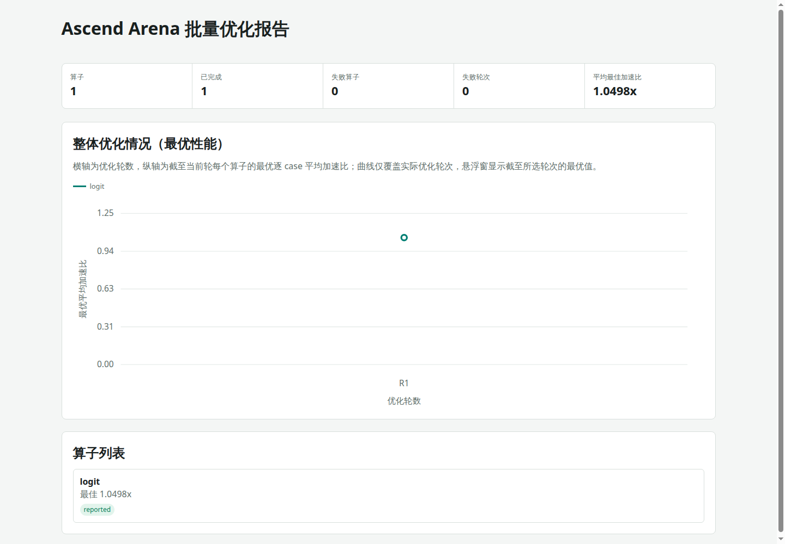
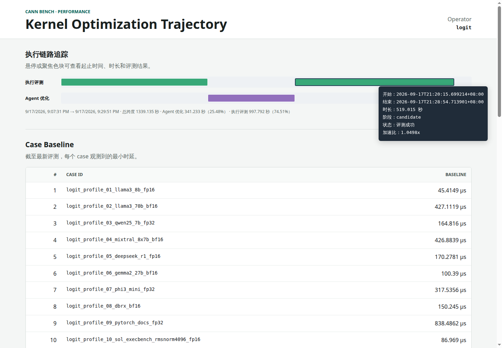

# CANN Bench 算子优化任务

在已有 Ascend C 实现上优化算子性能。系统负责编译、分阶段检查正确性、采集性能和生成报告。
每轮报告保存候选实现相对原始实现的源码差异。

每个任务有独立的**工作区（workspace）**。你修改其中的**候选实现**，再与原始实现的**基线**比较。
基线包含原始实现的正确性结果和性能数据。评测通过表示实现可用，性能收益需单独检查。

| 你要完成的任务 | 从这里开始 |
|---|---|
| 首次安装或定位安装错误 | [环境准备](#setup) |
| 自己修改源码，完成一次优化 | [手动优化 AdaptiveAvgPool3d](#quickstart) |
| 评测已有的实现 | [已有源码评测](#evaluate-source) |
| 检查全部 7 个原始算子 | [批量评测](#evaluate-all) |
| 用 Codex / Claude Code 优化 | [Agent 自动优化](#agent) |
| 接入外部 Agent 或自定义 skill | [扩展 Agent](#external-agent) |
| 理解正确性、加速比与耗时 | [结果与报告](#results) |
| 在容器内运行 | [Docker](#docker) |
| 反馈问题、分享实例或提交改进 | [Contribution](#contribution) |

除明确的 `cd` 外，命令均在仓库根目录执行。
示例使用 NPU 逻辑卡号 `1`，批量示例使用 `1,2,3`，请替换为自己的空闲卡。
默认编译目标为 Atlas A2（`ascend910b`）。A3 用户在创建任务前设置 `export ASCEND_ARENA_CHIP=ascend910_93`。
已验证环境和待验证范围见[兼容性说明](#troubleshooting)。
通用算子生成与评分流程见[通用评测说明](README_evaluation.md)。

<a id="setup"></a>

## 环境准备

运行环境为配有昇腾 NPU 的 Linux 服务器。
本文的项目环境脚本使用 Bash。在 Zsh 终端中，可先执行 `bash`，再按下面的步骤操作。

| 组件 | 要求 |
|---|---|
| 设备 | Atlas A2 或 A3，驱动与固件可用 |
| CANN | Toolkit 和对应芯片的 ops 包，版本与 Python 运行栈配套 |
| Python | 3.10 或更高，建议使用独立环境 |
| 构建工具 | Git、GCC/G++、Make、CMake、Ninja |
| 网络 | 首次安装需要访问 GitCode、Python 包源和安装包下载地址 |

按“检测 → 安装缺少的组件 → 验证”的顺序操作。
已安装的组件通过检测后，直接进入下一步。命令不可见时，检查安装路径与 Shell 初始化。
若已有驱动和 CANN，也可选择[环境脚本安装](#scripted-setup)。
已有系统 Python 与编译工具时，可用 [venv](#venv-setup) 替代 Conda 步骤。

<a id="manual-setup"></a>

### 1. 检查服务器与驱动

**先检测：**

```bash
uname -m
if command -v npu-smi >/dev/null 2>&1; then
  npu-smi info
  npu-smi info -m
else
  echo "当前 PATH 中未找到 npu-smi，请检查驱动安装与路径"
fi
if [ -r /usr/local/Ascend/driver/version.info ]; then
  cat /usr/local/Ascend/driver/version.info
fi
```

**检查点：** 架构应与后续安装包一致。`npu-smi` 应列出设备，`Chip Logic ID` 是评测使用的逻辑卡号。
查看设备是否空闲，并记录要使用的卡号。
能列出设备且驱动、固件与目标 CANN 配套时，跳过驱动和固件安装。

**如果失败：** 命令不可见时先检查 PATH。驱动已安装但设备不可见时，先检查驱动加载、权限和容器设备挂载。
只有确认驱动、固件缺失或不配套时，再请管理员处理对应安装。
Python 包安装不能替代这些步骤。

### 2. 手动准备 Python 与编译工具

**先检测 Conda：** 自定义安装目录可先设置 `ASCEND_ARENA_CONDA_BASE`。

```bash
ARENA_CONDA_BASE="${ASCEND_ARENA_CONDA_BASE:-}"
if [ -z "$ARENA_CONDA_BASE" ] && command -v conda >/dev/null 2>&1; then
  ARENA_CONDA_BASE="$(conda info --base)"
fi
if [ -z "$ARENA_CONDA_BASE" ]; then
  for arena_dir in "$HOME/miniconda3" "$HOME/miniforge3" "$HOME/anaconda3"; do
    if [ -r "$arena_dir/etc/profile.d/conda.sh" ]; then
      ARENA_CONDA_BASE="$arena_dir"
      break
    fi
  done
fi
if [ -n "$ARENA_CONDA_BASE" ] && [ -r "$ARENA_CONDA_BASE/etc/profile.d/conda.sh" ]; then
  echo "已有 Conda：$ARENA_CONDA_BASE，跳过下载安装"
  "$ARENA_CONDA_BASE/bin/conda" --version
else
  echo "未确认可用的 Conda，请核对安装路径后再决定是否安装"
fi
```

找到可用安装时，直接执行[加载当前终端的 Conda](#load-conda)。
只有确认缺失时，才运行下面的安装块。它会保留已检测到的安装和已有目录。

```bash
if [ -n "$ARENA_CONDA_BASE" ]; then
  echo "已有安装路径，请检查并复用：$ARENA_CONDA_BASE"
elif [ -e "$HOME/miniconda3" ]; then
  echo "目录已存在，请先检查 $HOME/miniconda3，不覆盖安装"
else
  ARENA_CONDA_BASE="$HOME/miniconda3"
  CONDA_INSTALLER="$(mktemp /tmp/miniconda.XXXXXX.sh)"
  if command -v curl >/dev/null 2>&1; then
    curl -fL "https://repo.anaconda.com/miniconda/Miniconda3-latest-Linux-$(uname -m).sh" \
      -o "$CONDA_INSTALLER"
  elif command -v wget >/dev/null 2>&1; then
    wget "https://repo.anaconda.com/miniconda/Miniconda3-latest-Linux-$(uname -m).sh" \
      -O "$CONDA_INSTALLER"
  else
    echo "请先准备 curl 或 wget" >&2
    false
  fi && bash "$CONDA_INSTALLER" -b -p "$ARENA_CONDA_BASE"
fi
```

若 `$HOME/miniconda3` 已存在，先检查其中的 `etc/profile.d/conda.sh`，使用已有安装。
若使用其他安装路径，请相应修改 `source` 命令。

<a id="load-conda"></a>

#### 加载当前终端的 Conda

已有安装和刚完成安装的用户，都需要在当前终端执行以下命令。
`source conda.sh` 加载激活环境所需的 Shell 函数，适用于 Bash 和 Zsh。

```bash
source "${ARENA_CONDA_BASE:-$HOME/miniconda3}/etc/profile.d/conda.sh"
conda --version
```

#### 创建项目环境

**先检测命名环境：**

```bash
conda env list
```

查询失败时先解决 Conda 初始化或路径问题，不继续创建环境。
已有 `ascend-arena` 时跳过创建，继续激活并检查 Python。
下面的代码块也会先检查名称，只在未找到时创建：

```bash
if ! ARENA_CONDA_ENVS="$(conda env list)"; then
  echo "查询 Conda 环境失败，请先解决上述错误" >&2
elif printf '%s\n' "$ARENA_CONDA_ENVS" | awk '$1 == "ascend-arena" { found=1 } END { exit !found }'; then
  echo "已有 ascend-arena，跳过创建"
  conda run -n ascend-arena python --version
else
  conda create -n ascend-arena --override-channels -c conda-forge -y \
    python=3.10 pip git curl 'cmake<4' ninja make 'libstdcxx-ng>=14'
fi
```

#### 激活并检查项目环境

无论环境是已有还是新建，都执行完整代码块：

```bash
source "${ARENA_CONDA_BASE:-$HOME/miniconda3}/etc/profile.d/conda.sh"
conda activate ascend-arena
echo "$CONDA_DEFAULT_ENV"
python --version
command -v python
cmake --version
git --version
```

**检查点：** 环境名应为 `ascend-arena`，Python 路径应位于对应环境的 `envs/ascend-arena/bin/`。
按上面的创建命令安装时，Python 版本应为 `3.10.x`。
激活失败时先停止后续安装，避免把依赖装进 base 环境。

若出现 `Run 'conda init' before 'conda activate'`，先重新加载上面的 `conda.sh`。
需要在新终端自动初始化时，按当前 Shell 选择命令，再重新打开终端：

| 当前 Shell | 初始化命令 |
|---|---|
| Bash | `conda init bash` |
| Zsh | `conda init zsh` |

可用 `ps -p $$ -o comm=` 检查当前 Shell。`conda init` 修改启动文件后，不会自动初始化已经打开的终端。

**先检测构建工具和编译器：**

```bash
for arena_tool in git curl cmake ninja make; do
  if command -v "$arena_tool" >/dev/null 2>&1; then
    echo "已找到 $arena_tool：$(command -v "$arena_tool")"
  else
    echo "缺少工具：$arena_tool"
  fi
done
command -v "${CC:-gcc}"
command -v "${CXX:-g++}"
"${CC:-gcc}" --version
"${CXX:-g++}" --version
conda list libstdcxx-ng
```

工具均可用且版本符合要求时，跳过安装。
只缺某项工具时，在当前环境单独补齐。CMake 使用 `cmake<4`，其他工具的 Conda 包名与上述命令相同。
例如只缺 Ninja 时执行：

```bash
if command -v ninja >/dev/null 2>&1; then
  echo "已有 Ninja，跳过安装"
else
  conda install --override-channels -c conda-forge -y ninja
fi
```

编译器缺失时，下面的代码块仅补齐缺少的编译器：

```bash
if ! command -v "${CC:-gcc}" >/dev/null 2>&1; then
  conda install --override-channels -c conda-forge -y c-compiler
fi
if ! command -v "${CXX:-g++}" >/dev/null 2>&1; then
  conda install --override-channels -c conda-forge -y cxx-compiler
fi
conda activate ascend-arena
"${CC:-gcc}" --version
"${CXX:-g++}" --version
```

**检查点：** Python 来自刚激活的环境，版本至少为 3.10。CMake、Git 和编译器均可运行。
CMake 低于 4，Conda 的 `libstdcxx-ng` 至少为 14。
已有版本不符合要求时，只在选定环境中处理对应包，不重新安装整个 Conda。
只有缺少或需要调整该运行库时，执行 `conda install --override-channels -c conda-forge -y 'libstdcxx-ng>=14'`。
Git 需支持 partial clone 与 sparse-checkout。

**如果失败：** 下载失败时先检查网络和安装包架构。环境已存在时先用 `conda env list` 确认名称。
已有环境缺少构建工具时，用 `conda install` 补齐对应包。

### 3. 获取项目

**先检测仓库：** 已在项目目录中时运行以下命令。

```bash
pwd
git rev-parse --show-toplevel
git branch --show-current
git status --short
```

已有仓库时直接使用该目录，跳过 `git clone`。
位于父目录时，可用 `git -C cann-bench-optimize status --short` 检查现有克隆。
只有确认没有仓库时，才执行下面的克隆命令。

```bash
git clone --branch codex/ascend-arena-bench-ops-perf-opti \
  https://gitcode.com/qq_45366264/cann-bench-optimize.git
cd cann-bench-optimize
```

**检查点：** 当前目录包含 `pyproject.toml`、`scripts/` 和 `bench_lab/`。
已有仓库的用户直接进入仓库，先检查分支及 `git status`，保留本地修改后再更新代码。

### 4. 手动安装并加载 CANN

**先检测已有安装，暂不运行安装包：**

```bash
echo "当前配置：${CANN_ENV_SCRIPT:-未设置}"
find "$HOME/Ascend" /usr/local/Ascend -maxdepth 4 -name set_env.sh 2>/dev/null
```

选择要使用的 Toolkit 环境脚本。已设置 `CANN_ENV_SCRIPT` 时保留该值，否则下面以 `cann/` 布局为例。
自定义路径需先修改变量，再检查编译器与 ops 的版本记录：

```bash
export CANN_ENV_SCRIPT="${CANN_ENV_SCRIPT:-$HOME/Ascend/cann/set_env.sh}"
if [ -r "$CANN_ENV_SCRIPT" ]; then
  source "$CANN_ENV_SCRIPT"
  command -v bisheng
  CANN_CHECK_ROOT="$(dirname "$(readlink -f "$CANN_ENV_SCRIPT")")"
  for arena_info in "$CANN_CHECK_ROOT/compiler/version.info" "$CANN_CHECK_ROOT/opp/version.info"; do
    if [ -r "$arena_info" ]; then
      echo "版本记录：$arena_info"
      cat "$arena_info"
    else
      echo "未找到版本记录：$arena_info，请先确认该版本的目录布局"
    fi
  done
else
  echo "未找到可读的 CANN 环境脚本，请先核对安装目录"
fi
```

旧版 CANN 的目录布局可能不同。缺少上述文件时，先查询该安装的版本记录或请管理员确认。

| 检测结果 | 下一步 |
|---|---|
| Toolkit 和目标芯片 ops 均已安装，版本配套 | 跳过两个安装包，保留环境加载，继续第 5 步 |
| Toolkit 已满足要求，缺少对应 ops | 只安装 ops |
| 已安装但版本或芯片不配套 | 选择配套安装或另建安装目录，保留已有版本 |
| 仅环境变量未加载或路径错误 | 修正路径并重新加载，跳过安装 |
| 确认没有 Toolkit | 按下面的步骤安装 Toolkit，再检查是否需要 ops |

**仅确认缺失后安装：**

按 [CANN 官方安装说明](https://www.hiascend.com/doc_center/source/en/CANNCommunityEdition/910/softwareinst/instg/instg_0008.html)准备 Toolkit 和 ops 安装包。
包的架构应与 `uname -m` 一致。ops 还需匹配 A2 或 A3 芯片，并与 Toolkit 安装到同一路径。

安装前核对 CANN、驱动、PyTorch 和 torch-npu 的配套要求，参见 [Ascend PyTorch 项目](https://gitcode.com/Ascend/pytorch)。
本仓库的 Python 安装约束以 [pyproject.toml](pyproject.toml) 为准，当前固定 `torch==2.10.0` 和 `torch_npu==2.10.0.post4`。
已有可用运行栈的用户先确认版本。如版本不同，请另建环境执行后续安装，保留原环境。

仅缺少 Toolkit 时，执行下面的安装命令。`VERSION`、`ARCH` 均需替换。
以下命令以普通用户的默认安装路径为例：

```bash
CANN_TOOLKIT_INSTALLER="/path/to/Ascend-cann-toolkit_VERSION_linux-ARCH.run"
ls -l "$CANN_TOOLKIT_INSTALLER"
bash "$CANN_TOOLKIT_INSTALLER" --help
bash "$CANN_TOOLKIT_INSTALLER" --install
```

安装成功后，选择该 Toolkit 的实际环境脚本。不同版本的目录名称可能不同。
复用已有安装时，也需加载选定的环境脚本：

```bash
find "$HOME/Ascend" /usr/local/Ascend -maxdepth 4 -name set_env.sh 2>/dev/null
```

下面以 `cann/` 布局为例。也可能是 `cann-9.0.0/` 或 `ascend-toolkit/latest/`，请先修改路径：

```bash
export CANN_ENV_SCRIPT="${CANN_ENV_SCRIPT:-$HOME/Ascend/cann/set_env.sh}"
source "$CANN_ENV_SCRIPT"
command -v bisheng
```

安装 ops 前，再检查所选 Toolkit 的 ops 版本记录。
若版本与芯片已满足要求，跳过 ops 安装：

```bash
CANN_CHECK_ROOT="$(dirname "$(readlink -f "$CANN_ENV_SCRIPT")")"
if [ -r "$CANN_CHECK_ROOT/opp/version.info" ]; then
  cat "$CANN_CHECK_ROOT/opp/version.info"
else
  echo "未找到 ops 版本记录，请先核对安装状态与目录布局"
fi
```

只有确认缺少目标版本 ops 时，才执行下面的命令。文件名需匹配芯片和 CPU 架构：

```bash
CANN_OPS_INSTALLER="/path/to/Ascend-cann-910b-ops_VERSION_linux-ARCH.run"
ls -l "$CANN_OPS_INSTALLER"
bash "$CANN_OPS_INSTALLER" --install
```

**检查点：** 两个安装包均报告成功，`bisheng` 能输出路径。
系统级安装或自定义安装路径需按官方说明设置权限与 `--install-path`，Toolkit 与 ops 使用同一目标路径。
已有 Toolkit 和 ops 的用户只需选择环境脚本并检查工具链。

**如果失败：** `set_env.sh` 不存在时重新核对安装结果和路径。
`bisheng` 找不到时确认加载的是 Toolkit 环境。
缺少算子库或芯片不匹配时，检查 ops 包，不能仅安装 Toolkit。

### 5. 安装项目 Python 依赖

Conda 用户先让项目脚本加载当前环境、CANN 和 C++ 运行库：

```bash
export ASCEND_ARENA_CONDA_BASE="$(conda info --base)"
export ASCEND_ARENA_ENV_NAME=ascend-arena
source scripts/activate_ascend_arena_env.sh
```

**先检测 pip、已安装依赖和可用性：** `env -u PYTHONPATH` 避免检查时混入 CANN 额外加入的 Python 包。

```bash
python -m pip --version
env -u PYTHONPATH PYTHONNOUSERSITE=1 python - <<'PY'
from importlib.metadata import PackageNotFoundError, version

packages = (
    "build", "pybind11", "torch", "torch_npu", "numpy", "pyyaml", "scipy",
    "pandas", "decorator", "attrs", "cloudpickle", "ml-dtypes", "psutil",
    "tornado", "expecttest", "jinja2", "protobuf", "ruamel.yaml",
)
for package in packages:
    try:
        print(f"{package}: {version(package)}")
    except PackageNotFoundError:
        print(f"{package}: 未安装")
PY
env -u PYTHONPATH PYTHONNOUSERSITE=1 python -m pip check
python -c 'import torch, torch_npu; print(torch.__version__, torch_npu.__version__)'
```

所有依赖均已安装、版本满足 `pyproject.toml`、`pip check` 与模块导入均通过时，跳过安装。
`pip check` 只检查已登记包的依赖，不能替代上面的缺包检查与项目版本核对。
pip 已可用时保留现有版本。

只有缺少 pip 时，Conda 用户用 `conda install --override-channels -c conda-forge -y pip` 补齐。
venv 用户可用 `python -m ensurepip` 准备 pip。

**仅缺少项目依赖时安装：**

```bash
PYPI_INDEX="${ASCEND_ARENA_PYPI_INDEX_URL:-https://mirrors.huaweicloud.com/repository/pypi/simple}"
env -u PYTHONPATH PYTHONNOUSERSITE=1 python -m pip install \
  --index-url "$PYPI_INDEX" .
```

pip 会复用已满足版本约束的依赖。已有包版本与项目要求不同，先选择配套环境，再执行安装。
安装后重新运行上述检测块，确认没有缺项、依赖冲突或导入错误。

**如果失败：** 先看终端的第一条安装错误。
`No matching distribution` 时检查 Python、CPU 架构、包源和固定版本的 wheel 是否可用。
缺少 Python 包时，确认安装与执行使用同一个 `python`，再重试项目依赖安装。
`CXXABI_* not found` 的处理见[排错表](#troubleshooting)。

<a id="venv-setup"></a>

<details>
<summary>使用系统 Python + venv</summary>

适用于已有系统编译工具和 Python 3.10+ 的环境。
**先检测系统依赖：** 以下包检查仅适用于 Ubuntu/Debian。

```bash
dpkg-query -W -f='${Package}: ${Status}\n' \
  git curl build-essential python3 python3-dev python3-pip python3-venv
python3 --version
```

只对未安装的包运行 `sudo apt-get install -y 包名`。
例如仅缺少 `python3-venv` 时，只安装该包，保留其他组件。

**先检测 venv：**

```bash
if [ -r .venv/bin/activate ]; then
  .venv/bin/python --version
  echo "已有 .venv，跳过创建"
elif [ -e .venv ]; then
  echo "已有 .venv 目录但未确认可用，请先检查，不覆盖创建"
else
  python3 -m venv .venv
fi
source .venv/bin/activate
python -m pip --version
command -v cmake
command -v ninja
```

Python 需满足版本要求。CMake 与 Ninja 已可用时跳过安装，缺失时单独补齐：

```bash
if ! command -v cmake >/dev/null 2>&1; then
  python -m pip install 'cmake<4'
fi
if ! command -v ninja >/dev/null 2>&1; then
  python -m pip install ninja
fi
```

随后加载 `CANN_ENV_SCRIPT`，执行本步骤中的项目依赖安装与检查命令。
最后设置源码路径：

```bash
source "$CANN_ENV_SCRIPT"
export PYTHONPATH="$PWD/src${PYTHONPATH:+:$PYTHONPATH}"
```

venv 用户不执行 Conda 激活脚本。C++ 运行库由系统环境提供，需满足编译和加载要求。

</details>

### 6. 初始化固定版本的源码依赖

**先做只读检测：**

```bash
git submodule status
git submodule foreach --quiet 'git status --short'
python - <<'PY'
import json
import runpy
from pathlib import Path

dependency = Path("src/ascend_arena_e2e/dependency")
assert (dependency / "baselines").is_dir(), "尚未生成 baselines"
manifest = json.loads((dependency / "baselines.json").read_text())
module = runpy.run_path("scripts/setup_ascend_arena_dependencies.py")
module["verify_baselines"](dependency / "baselines", manifest)
print("基线文件与清单一致")
PY
```

四个子模块的状态前缀均为空格、工作区干净且基线校验通过时，跳过初始化。
前缀 `-` 表示未初始化，`+` 表示提交不一致，`U` 表示冲突。
版本不一致或存在本地修改时先保存并处理，不能当作未安装直接覆盖。

**仅缺少依赖或生成基线时初始化：**

```bash
python3 scripts/setup_ascend_arena_dependencies.py
git submodule status
test -f src/ascend_arena_e2e/dependency/ops-skeleton/ops_optimization_skeleton/CMakeLists.txt
```

**检查点：** 脚本输出 `Arena build sources and baselines are ready`，四个子模块提交与主仓固定版本一致。
`test` 命令成功退出，表示骨架构建入口存在。

| 依赖 | 下载与使用范围 |
|---|---|
| `ops-skeleton` | 官方 multimodal-benchmark 的 `ops_optimization_skeleton/` |
| `ops-base` | 骨架要求的固定版本 opbase，保留完整源码与 Git 元数据 |
| `ops-nn`、`ops-transformer` | 7 个算子需要的实现、公共依赖与许可证 |
| `baselines/` | 按清单校验官方源码并应用兼容补丁后生成的基线 |

脚本采用部分克隆与稀疏检出，不递归初始化其他子模块。
服务端不支持过滤时，稀疏工作区仍生效，但对象下载量可能增加。
已经下载的完整 Git 对象会保留。

**如果失败：** 网络错误时检查 GitCode 访问并重试。
脚本发现子模块或生成基线有本地修改时会停止，请先保存修改。
未知 Git 选项需升级 Git。更新版本、来源清单和基线哈希问题见[依赖说明](src/ascend_arena_e2e/dependency/README.md)。

初始化完成后评测可离线运行。离线搬运需保留主仓 `.git`、四个子模块和生成的 `baselines/`。
评测器在隔离目录编译骨架，opbase 从固定检出共享读取。
使用外部 opbase 时，`OPBASE_SOURCE_PATH` 须指向干净的固定提交，具体版本见依赖说明。

**检测测量辅助算子：** 默认性能采集需要项目自带的预热和清缓存算子。

```bash
python -c "from cann_bench_utils import cann_bench_warmup, cann_bench_cache_clean; from cann_bench_utils.build_info import check_build_compatibility; print(check_build_compatibility('src/cann_bench_utils'))"
```

导入、构建环境和源码指纹检查通过时跳过安装。缺失、环境不匹配或辅助源码更新后，在已加载 CANN 的项目环境中执行：

```bash
bash -c 'source scripts/ensure_cann_bench_utils.sh; ensure_cann_bench_utils'
```

脚本先检查已有安装，再按需编译和安装。失败时检查 `/tmp/cann_bench_utils_build.log` 或 `/tmp/cann_bench_utils_install.log`，修复后重新运行导入检测。

### 7. 在选定卡上做一次计算检查

先重新查看 `npu-smi info`，确认示例逻辑卡 `1` 可用。需要使用其他卡时修改 `device_id`：

```bash
python - <<'PY'
import torch
import torch_npu

device_id = 1
assert torch.npu.device_count() > device_id, "所选 NPU 不可见"
torch.npu.set_device(device_id)
x = torch.tensor([1.0, 2.0], device=f"npu:{device_id}")
torch.testing.assert_close((x + 1).cpu(), torch.tensor([2.0, 3.0]))
torch.npu.synchronize()
print(f"NPU {device_id} 计算检查通过")
PY
```

**检查点：** 命令输出计算检查通过。
设备不可见时检查权限、容器映射和可见设备配置。
模块可导入但计算失败时，核对 CANN、驱动、芯片与 torch-npu 的配套关系。

### 8. 在新终端恢复环境

Conda 用户复用前面选择的路径。下面仍以用户级 Miniconda 和 `cann/` 布局为例：

```bash
cd /path/to/cann-bench-optimize
export ASCEND_ARENA_CONDA_BASE="$HOME/miniconda3"
export ASCEND_ARENA_ENV_NAME=ascend-arena
export CANN_ENV_SCRIPT="$HOME/Ascend/cann/set_env.sh"
source scripts/activate_ascend_arena_env.sh
```

自定义 Conda 路径、环境名或 CANN 路径时，修改相应的 `export` 值。
环境脚本安装成功后会保存 `.ascend_arena_env`，使用该记录的用户可直接执行激活命令。

venv 用户执行：

```bash
cd /path/to/cann-bench-optimize
source .venv/bin/activate
export CANN_ENV_SCRIPT="/实际的/Toolkit/路径/set_env.sh"
source "$CANN_ENV_SCRIPT"
export PYTHONPATH="$PWD/src${PYTHONPATH:+:$PYTHONPATH}"
```

<a id="scripted-setup"></a>

<details>
<summary>已有驱动和 CANN：使用环境脚本安装</summary>

**先检测：** 完成上面的驱动、Conda、CANN、Python 依赖与源码依赖检查。
全部满足时，跳过安装脚本，只激活已有环境：

```bash
source scripts/activate_ascend_arena_env.sh
```

存在缺项且希望由脚本准备环境时，再执行：

```bash
export CANN_ENV_SCRIPT="/实际的/Toolkit/路径/set_env.sh"
bash scripts/setup_ascend_arena_env.sh
source scripts/activate_ascend_arena_env.sh
```

源码依赖仍按第 6 步的检测结果决定是否初始化。
脚本分 6 个阶段准备 Conda、安装依赖、加载 CANN 并做真实 NPU 计算。
它使用 conda-forge，完成后将环境路径保存在 Git 忽略的 `.ascend_arena_env`，不执行 `conda init`。
脚本内置计算检查使用逻辑卡 `0`。需要在其他卡检查时，采用上面的手动步骤。

某阶段失败时保留第一条错误和阶段编号，再按对应手动步骤检查。
脚本会创建或更新所选 Conda 环境。需要精确地只补某个缺项时，使用上面的手动步骤。
已有实验环境可另设 `ASCEND_ARENA_ENV_NAME`。

</details>


<a id="quickstart"></a>

## 快速入门：优化一个 AdaptiveAvgPool3d 算子

先完成[环境准备](#setup)，再用 `adaptive_avg_pool3d` 完成以下流程。其他任务见[算子列表](#operators)。

<a id="prepare-workspace"></a>

### 1. 创建工作区

以下命令从仓库根目录执行。
示例使用 NPU 逻辑卡号 `1`。请先将卡号改为自己的空闲卡。
`npu-smi info -m` 中的 `Chip Logic ID` 是这里使用的逻辑卡号。

```bash
./scripts/run_auto_pipeline.sh prepare \
  --operator adaptive_avg_pool3d \
  --device-id 1 \
  --output benchmark_runs/manual \
  --workspace-only
```

`--workspace-only` 只创建文件，不运行编译、评测或 Agent。
工作区位于 `benchmark_runs/manual/adaptive_avg_pool3d/work/`。

<a id="evaluate-workspace"></a>

### 2. 初始化基线

进入工作区，采集原始实现的结果：

```bash
cd benchmark_runs/manual/adaptive_avg_pool3d/work
./validate.sh init --device-check require-idle
```

等待编译、三阶段正确性检查和性能采集全部完成。
基线保存在 `kernel_eval/init_results/`。
后续评测复用这份基线，不需要每轮执行 `init`。
评测沿用当前激活的 CANN 环境；测量辅助算子也使用该版本构建。

`require-idle` 会在卡被占用或状态未知时停止评测。
空闲检查不锁定设备。评测期间请保持该卡独占。

### 3. 修改并评测候选实现

只修改工作区中的 `adaptive_avg_pool3d/`。
主要实现位于 `adaptive_avg_pool3d/op_host/` 和 `adaptive_avg_pool3d/op_kernel/`。
`binding/`、`cases/`、`reference.py` 和 `api_desc.md` 是评测资产，保持它们不变。
工作区的 `cases/` 包含 smoke 用例、输入生成代码和接口规格；complete/profile 用例由 `validate.sh` 从仓库对应任务目录读取。
保留基线、`workspace.json` 和 `validate.sh`。

每次修改后，在当前工作区执行：

```bash
./validate.sh --device-check require-idle
```

评测依次检查编译、smoke 小测试集、complete 完备测试集和 profile 测试集正确性。
正确性检查完成后，系统采集性能。
编译或正确性失败时，命令返回非零退出码。

只检查编译和正确性时，使用 `./validate.sh --no-perf --device-check require-idle`。
该模式不采集性能，也不生成加速比。

### 4. 查看结果

用浏览器打开工作区中的 `kernel_eval/optimization_trajectory.html`，查看各轮变化。
单次评测报告与原始数据保存在同一工作区中：

| 路径 | 内容 |
| --- | --- |
| `adaptive_avg_pool3d/` | 当前候选源码 |
| `kernel_eval/init_results/` | 原始基线 |
| `kernel_eval/ascend_arena_adaptive_avg_pool3d_<时间>_<ID>/` | 本次评测的 HTML、Markdown、JSON 报告及 `comparison.json` |
| 本次评测目录中的 `results/status.json` | 编译、评测及性能采集状态 |
| 本次评测目录中的 `results/` | 各阶段正确性明细和性能原始数据 |

按[五阶段说明与查看命令](#evaluation-stages)检查阶段结果，再查看加速比和观测噪声。
加速比大于 `1` 表示该用例的候选耗时更低。评测通过不代表性能提升。
重复比较时，使用同一张卡和相同的采样设置。

没有修改源码的评测不计入优化轮次，单次报告仍可查看。
报告字段和计时口径见[结果说明](#results)。

默认预热 10 次、采样 30 次。需要调整时，使用 `--warmup` 和 `--repeat`。
仅重建轨迹报告时，在工作区执行 `./validate.sh only-html`，无需重新评测。

<a id="evaluate-source"></a>
<a id="evaluate"></a>

## 评测已有源码

以下命令从仓库根目录执行。

适合已有原始或优化源码的用户，直接完成“原始实现 → 候选实现”的编译、三阶段正确性和性能对比，无需创建 workspace。

```bash
./scripts/run_evaluation.sh --run_optimize \
  --operator adaptive_avg_pool3d --device-id 1 \
  --source-dir bench_lab/ascend_arena_bench/adaptive_avg_pool3d/adaptive_avg_pool3d \
  --task-dir bench_lab/ascend_arena_bench/adaptive_avg_pool3d \
  --reports-dir benchmark_runs/evaluate/adaptive_avg_pool3d/kernel_eval \
  --device-check require-idle
```

| 参数 | 含义 |
|---|---|
| `--run_optimize` | 使用本文的 Ascend Arena 评测流程 |
| `--operator adaptive_avg_pool3d` | 算子注册名称，见[算子列表](#operators) |
| `--device-id 1` | 本次使用的一张卡 |
| `--source-dir` | 待评测的候选源码目录，包含 `op_host/`、`op_kernel/` 等实现 |
| `--task-dir` | 仓库原始算子与评测资产目录，作为比较基准 |
| `--reports-dir` | 本次评测产物的父目录 |

首次测试可直接运行上面的命令：两侧源码相同，加速比通常接近 1。有优化好的实现时，
将 `--source-dir` 换成其路径，其余参数不变。原始实现和评测资产应保持不变。

终端依次显示编译、smoke 小测试集、complete 完备测试集、profile 测试集正确性及各 case 的微秒时延。
结果在 `benchmark_runs/evaluate/adaptive_avg_pool3d/kernel_eval/ascend_arena_adaptive_avg_pool3d_<时间>_<ID>/`：
`baseline_results/` 是原始结果，`results/` 是候选结果，`comparison.json` 是性能对比。
原始评测失败会停止流程。具体字段见[结果说明](#results)。

<a id="evaluate-all"></a>

## 批量评测全部算子

```bash
python tests/run_ascend_arena_batch_e2e.py --devices 1,2,3 \
  --output benchmark_runs/evaluate-all
```

脚本覆盖注册的全部 7 个算子，对原始实现和同源码候选分别验证编译、三阶段正确性与性能采集。
`--devices` 限定允许使用的卡，所选卡必须存在且空闲。省略该参数会发现当前全部空闲卡。
并发数为使用卡数（最多 8），每卡同时执行一个算子，剩余算子排队。`--output` 应使用新的结果目录。
省略时自动生成带时间戳的目录。

汇总为 `benchmark_runs/evaluate-all/e2e_summary.json`，记录实际卡、并发、各算子状态。
每个算子的 `<算子>/evaluation.log` 和 `<算子>/kernel_eval/` 保存明细。
这是源码入口的批量测试。完整验收还需覆盖 workspace 入口：

```bash
python tests/run_ascend_arena_batch_e2e.py --mode workspace --devices 1,2,3 \
  --output benchmark_runs/workspace-check
```

`--mode source`（默认）走源码评测入口。`--mode workspace` 对每个算子依次执行
仅构建工作区、`./validate.sh init`、`./validate.sh`。两种模式均按空闲卡调度，每卡一个任务。
省略 `--devices` 自动选空闲卡。初始化失败时跳过该算子的候选评测，继续处理其他算子。

workspace 模式的结果在 `<输出目录>/<算子>/work/kernel_eval/`，日志仍为
`<输出目录>/<算子>/evaluation.log`，总表为 `e2e_summary.json`，其中 `mode` 区分入口，
`prepare_returncode`、`baseline_returncode`、`candidate_returncode` 记录各步骤退出码。
未执行的步骤为 `null`。任一算子失败时批次返回非零。
两种入口都需核对阶段正确性和性能采集数量，按[测试报告模板](docs/templates/ascend_arena_user_evaluation_report.md)记录阶段结果与完整验收覆盖。


<a id="agent"></a>

## Agent 自动优化

<a id="optimize-one"></a>

### 配置 Agent 并优化一个算子

先配置一次 Agent，再启动优化。需要 Node.js 22+ 和可访问的模型服务。
**先检测 Node.js：** 有 NVM 时先加载，避免把 PATH 未生效误判为未安装。

```bash
if [ -r "${NVM_DIR:-$HOME/.nvm}/nvm.sh" ]; then
  source "${NVM_DIR:-$HOME/.nvm}/nvm.sh"
fi
command -v node
node --version
command -v npm
npm --version
```

Node.js 和 npm 已可用且版本符合要求时，跳过安装。
确认缺失后按 [Node.js 安装说明](https://nodejs.org/en/download)配置。
已有旧版 Node.js 时，先检查是否有可切换的配套版本。

**先检测所选 Agent CLI：** 只需准备要使用的 CLI，已有可用安装时保留现有版本。
下面的版本用于缺失时安装示例，并非最低兼容版本。

选用 Codex 时执行：

```bash
if command -v codex >/dev/null 2>&1; then
  codex --version && echo "已有 Codex CLI，跳过安装"
else
  npm install -g @openai/codex@0.150.1
fi
```

选用 Claude Code 时执行：

```bash
if command -v claude >/dev/null 2>&1; then
  claude --version && echo "已有 Claude Code，跳过安装"
else
  npm install -g @anthropic-ai/claude-code@2.1.220
fi
```

命令存在但无法运行时，先检查 Node.js、可执行文件和架构，不直接重装。
安装完成后重新执行所选 CLI 的 `--version` 检查。

**先检测配置文件，再复制示例：**

```bash
if [ -f src/ascend_arena_e2e/agents/.env ]; then
  echo "已有 Agent 配置，保留原文件"
else
  cp -n src/ascend_arena_e2e/agents/.env.example src/ascend_arena_e2e/agents/.env
fi
```

已有 `.env` 时上述复制命令保留原文件。
编辑 `src/ascend_arena_e2e/agents/.env`（YAML 格式），填写自己的服务信息。例如：

```yaml
claude-code:
  harness: claude-code
  api_key: "<你的 API Key>"
  base_url: "<你的 Claude 兼容服务地址>"
  model: "<服务支持的模型名>"
  model_reasoning_effort: high
```

`claude-code` 是运行时选择的 profile 名。`harness` 指向 Agent 类型。其余字段分别为密钥、
服务地址、模型和推理强度。Codex 对应 `harness: codex`，配置示例见 `.env.example`。
若网关要求 `Authorization: Bearer`，在 Claude Code 的 `agents/.env` profile 中设置
`auth_type: bearer`。默认 `api-key` 使用 `x-api-key`。模型名须与网关路由配置完全一致。

密钥只放在被 Git 忽略的 `.env` 中。Claude 指定密钥或地址时使用私有配置目录，
避免个人 settings 覆盖。建议从 `high` 开始。宿主机运行 Claude 请使用普通用户。

```bash
./scripts/run_auto_pipeline.sh prepare --operator adaptive_avg_pool3d --device-id 1 \
  --output benchmark_runs/claude-adaptive_avg_pool3d --agent claude-code --agent-timeout 3600
```

`--agent` 选择 profile。`--agent-timeout` 为单次 Agent 会话上限秒数，包含评测等待，
默认 0 不限制。需要自定义目标可加 `--goal "你的优化目标"`，或用
`--agent-prompt "你的任务说明"` 替换启动 prompt。`AGENTS.md` 仍由所选 Agent 生成。

会话超时返回 `124`。工作区源码、已完成的评测和优化轨迹继续保留。
各轮报告的 `source_diff` 记录实现差异与源码指纹，可用于接续优化。

执行顺序：构建 `benchmark_runs/claude-adaptive_avg_pool3d/adaptive_avg_pool3d/work/` → 采集原始基线 →
启动 Agent → Agent 修改源码并调用 `./validate.sh` → 检查最终源码与完整评测结果。
Agent 根据评测反馈继续修改和验证。验收要求 Agent 正常退出，且最终源码匹配完整通过的评测；实际轮次见轨迹报告。
性能收益见逐 case 的 `speedup`、`noise_band` 和 `significant`。

日志实时写入 `work/artifact/claude-code.log`，包含 prompt 和工具输出。
`work/artifact/agent.pid` 记录运行中的宿主 CLI PID。优化结果和源码分别在
`work/kernel_eval/` 与 `work/adaptive_avg_pool3d/`。中断后在同一命令追加 `--resume`，保留源码与成功基线继续运行。

<a id="optimize-all"></a>

### 批量优化与恢复

完成[Agent 单算子优化](#optimize-one) 的 Agent 配置后执行：

```bash
./scripts/batch_optimize.py --agent claude-code --devices 1,2,3 \
  --output benchmark_runs/claude-all --agent-timeout 3600
```

不传 `--operators` 即选择全部 7 个算子。只测子集时传 `--operators adaptive_avg_pool3d,group_quant`。
`--devices` 决定卡号及并发数，每卡一个任务。批量优化默认卡号为 0，**不会自动选空闲卡**，
请明确指定自己的空闲卡。每个算子初始化完成后立即启动其 Agent，不等待其他算子。
不传 `--output` 时目录为 `benchmark_runs/<agent>-<model>/`。

```text
benchmark_runs/claude-all/
├── config.json        # 参数、模型、设备和 invocations 调用记录
├── progress.json      # 每个算子的状态
├── report.html        # 自包含总报告，点击算子展开轨迹
└── <算子>/work/       # 每个算子独立的源码、日志、基线和评测结果
```

再次执行同一命令会跳过“Agent 正常退出且最终源码匹配完整成功评测”的算子。
失败、中断、超时或最终源码未验证的算子继续执行。到达会话时限后，记录 `timeout` 和
`agent_run.returncode=124`，保留实现、优化轨迹和已通过的评测成绩。总报告单独统计“会话到时”。
命令退出码：`0` 表示完成，`124` 表示会话到时，`1` 表示任务失败；批次同时存在失败和到时任务时返回 `1`。

`--restart` 重新执行所选算子的 Agent，保留现有实现及成功基线。`--force` 重建所选 workspace，
会替换其中的源码与结果，使用前自行归档。子集重跑保留其他算子的 config/progress。
不指定 `--agent` 时仅准备并初始化各工作区，不启动优化。它不同于[创建工作区](#prepare-workspace) 的纯文件构建。

<a id="external-agent"></a>

### 接入外部 Agent

此路径无需继承框架类。先按[创建工作区](#prepare-workspace) 只构建 workspace，然后：

```bash
cd benchmark_runs/manual/adaptive_avg_pool3d/work
./validate.sh init
```

在这个 `work/` 目录中启动自己的 Agent，传给它工作目录及以下任务说明
（具体启动命令由你的 Agent 决定）：

> 读取 api_desc.md，只修改 adaptive_avg_pool3d/ 中的实现。保持评测资产与基线不变。
> 每次有意义的修改后执行 ./validate.sh，读取 kernel_eval 中最新一轮的正确性与性能对比，
> 再决定是否继续修改。结束前对最终源码完成一次成功评测。

可由自己的 Agent 写入 `AGENTS.md` 或使用自身的 prompt 配置。外部 Agent 自行管理模型密钥、
进程、预算与日志。评测结果仍由 `validate.sh` 统一生成。分享结果时回到仓库根目录执行：

```bash
python scripts/generate_batch_report.py benchmark_runs/manual
```

得到 `benchmark_runs/manual/report.html`，无需 `config.json` 也能发现算子和轨迹。
外部 Agent 的会话时间未接入框架计时，报告中不要推算其 Agent 耗时。

<a id="custom-agent-batch"></a>
<a id="添加自己的-agent"></a>

<details>
<summary>自定义 Agent 与 skill 的完整接入示例</summary>

### 封装自定义 Agent

以用户提供的 **cannbot skill + Claude Code** 为例：Claude Code 执行 skill 中的优化指引，
自定义类负责把 skill 接入工作区，框架负责设备调度、初始化、日志、超时、续跑与评测结果判定。
先完成[Agent 单算子优化](#optimize-one) 的 Claude Code 安装。以下示例在宿主机运行。

#### 1. 指定 skill 路径并封装 Agent

保留完整 skill 目录（包括其引用的脚本和参考文件），指定其中的入口文件：

```bash
export CANNBOT_SKILL_PATH="/你的路径/cannbot/SKILL.md"
```

新建 `src/ascend_arena_e2e/agents/cannbot.py`：

```python
import os
from pathlib import Path

from ascend_arena_e2e.agent_base import register_agent
from ascend_arena_e2e.agents.claude_code import ClaudeCodeAgent


@register_agent
class CannbotAgent(ClaudeCodeAgent):
    name = "cannbot"

    def _skill_path(self) -> Path:
        skill = os.environ.get("CANNBOT_SKILL_PATH", "")
        if not skill:
            raise ValueError("请设置 CANNBOT_SKILL_PATH，指向 cannbot 的 SKILL.md")
        path = Path(skill).expanduser().resolve()
        if not path.is_file():
            raise ValueError(f"skill 文件不存在：{path}")
        return path

    def preflight(self, *, docker: bool = False) -> None:
        super().preflight(docker=docker)
        self._skill_path()

    def setup_agents_md(self, workspace: Path) -> None:
        super().setup_agents_md(workspace)
        skill_path = self._skill_path()
        with (workspace / "AGENTS.md").open("a", encoding="utf-8") as handle:
            handle.write(
                f"\n## Cannbot skill\n"
                f"- 开始优化前，读取并遵循 `{skill_path}`。\n"
                f"- skill 中的相对资源路径以 `{skill_path.parent}` 为基准。\n"
                "- 在当前工作区修改算子，保留上述评测资产和基线约束。\n"
                "- 使用 ./validate.sh 评测，结束前验证最终实现。\n"
            )
```

`ClaudeCodeAgent` 已继承 `OperatorAgent`，因此只需注册名称、检查路径和扩展上下文。
环境变量设置、`claude -p` 命令、工作区 cwd、日志及结果检查均复用已有实现。
批量 worker 会创建 Agent 实例，示例在写入 `AGENTS.md` 时重新读取 skill 路径。默认 prompt 要求读取
`AGENTS.md`，其中再指向 cannbot skill。可从 `artifact/cannbot.log` 核对 Agent 是否实际读取了文件。

#### 2. 配置模型服务

在 `src/ascend_arena_e2e/agents/.env` 中新增 profile（YAML）：

```yaml
cannbot:
  harness: ascend_arena_e2e.agents.cannbot:CannbotAgent
  api_key: "<你的 Claude 兼容服务 API Key>"
  base_url: "<你的 Claude 兼容服务地址>"
  model: "<该服务支持的模型>"
  model_reasoning_effort: high
```

`harness` 的 `模块:类名` 用于加载自定义类。`--agent cannbot` 选择这个 profile。
模型参数沿用[Agent 单算子优化](#optimize-one)，skill 路径通过 `CANNBOT_SKILL_PATH` 单独传入，不在 `.env` 中增加字段。
密钥只用于模型服务，不写入 skill 或 `AGENTS.md`。

#### 3. 先验证接入，再批量优化

```bash
# 先跑一个算子，确认 skill 能被读取并完成评测
./scripts/batch_optimize.py --agent cannbot --operators adaptive_avg_pool3d --devices 1 \
  --output benchmark_runs/cannbot-check --agent-timeout 3600

# 全部 7 个算子，使用独立批次目录
./scripts/batch_optimize.py --agent cannbot --devices 1,2,3 \
  --output benchmark_runs/cannbot-all --agent-timeout 3600
```

`--operators` 限定算子，省略即全部。`--devices` 设置卡号与并发。`--output` 设置结果根目录。
`--agent-timeout` 是每次 Agent 会话的秒数上限，包含评测等待。新终端运行前需重新设置 skill 路径。
每个任务在 `<输出目录>/<算子>/work/` 中加载同一份 skill，修改各自源码并调用 `./validate.sh`。
日志为 `artifact/cannbot.log`，结果在 `kernel_eval/`，批次总页为 `<输出目录>/report.html`。

skill 及其依赖应允许各任务独立运行，使用框架分配的设备。共享 skill 目录保持只读使用，
临时文件写入各自 workspace。若 skill 需要额外工具，应按其说明提前安装。
本例的外部 skill 目录不会自动挂载到 Docker。容器使用需另外提供容器内可读的完整目录及路径。


</details>

<a id="results"></a>

## 结果、报告与耗时

<a id="evaluation-stages"></a>

### 五个评测阶段

评测按下表顺序执行。某个阶段失败后，后续阶段停止。
smoke、complete 和 profile correctness 都比较候选输出与参考结果，覆盖的用例范围不同。

| 阶段（`stages` 中的名称） | 检查内容 | 保留的结果 JSON |
|---|---|---|
| 编译（`compile`） | 编译算子与验证扩展，检查所需构建产物 | `compile_result.json` |
| smoke 正确性（`smoke`） | 用少量代表性用例快速检查基本功能。每个用例使用 3 个随机种子，全部通过才算通过 | `smoke-correctness_result.json` |
| complete 正确性（`complete`） | 用扩展的形状、dtype、属性和边界用例检查功能覆盖。标记为 `lint-only-coverage` 的用例不执行 | `complete-correctness_result.json` |
| profile 正确性（`profile_correctness`） | 对即将采集性能的 profile 用例检查输出，确保计时前结果正确 | `profile-correctness_result.json` |
| 性能采集（`performance`） | 对 profile 用例预热并重复计时，保存时延样本。该阶段的“通过”表示采集成功 | `result.json` |

`--no-perf` 仍执行编译和三个正确性阶段，性能采集标记为 `skipped`。
该模式没有性能值和加速比。smoke 用例的三次运行不计作三个不同用例。

#### 查看五阶段状态与正确性明细

记 `W=<输出目录>/<算子>/work`，`R=<评测目录>/ascend_arena_<算子>_<时间>_<ID>`。
workspace 的评测目录为 `W/kernel_eval`。源码评测入口使用 `--reports-dir` 指定评测目录。
候选结果在 `R/results/`，原始基线在 `W/kernel_eval/init_results/` 或 `R/baseline_results/`。
下文的 JSON 路径均相对于对应的结果目录。

评测结束后，结果已自动保存在文件中。按以下顺序直接查看：

1. 用编辑器打开 `R/results/status.json`，查看五阶段状态和用例计数。
2. 需要某个阶段的明细时，打开其 `result_json` 指向的文件。该路径相对于 `status.json` 所在目录。
   例如 `"result_json": "smoke-correctness_result.json"` 对应同一目录中的该文件。
3. 用浏览器打开 `R/<运行目录名>.html`，或用 Markdown 阅读器打开同名 `.md`，查看优化前后的逐 case 性能对比。

`status.json` 的字段含义如下：

- `stages` 列出上述五个阶段，`status` 为 `passed`、`failed`、`skipped`、`not_run`、`interrupted` 或 `unknown`。
  分别表示通过、失败、按配置跳过、尚未执行、中断和证据不足。
- `stages.<阶段>.success` 在通过时为 `true`，失败时为 `false`，其他状态为 `null`。
- `all_stages_passed=true` 表示五阶段全部通过。`success` 表示本次请求的流程成功，因此 `--no-perf` 成功时两者不同。
- `result_json` 指向保留的结果文件。三个正确性阶段还提供 `total_cases`、`passed_cases`、`failed_cases`。
- 正确性 JSON 的 `case_results` 提供逐 case 的 `passed`、`passed_runs`、`total_runs` 和误差数据。
  `passed_runs=total_runs` 表示该用例的所有随机种子运行通过。

例如，直接在 `status.json` 中查看下面的字段，即可确认 smoke 阶段的结果。
以下为字段示例，省略其余阶段与字段：

```json
{
  "stages": {
    "smoke": {
      "status": "passed",
      "total_cases": 5,
      "passed_cases": 5,
      "failed_cases": 0,
      "result_json": "smoke-correctness_result.json"
    }
  }
}
```

请求的阶段全部成功后，系统清理阶段日志。此时 `log`、`compile_log`、`profile_log` 为 `null`，
使用 `result_json` 查看结果。失败或证据不足时保留可用日志。没有执行的阶段不会标为通过。
未产生结果 JSON 时，`result_json` 为 `null`。
`--profile-artifacts compact` 还会删除成功评测的 profiler 原始目录，保留上述结果 JSON 和对比报告。

### 结果文件与指标

#### 查看优化前后的性能指标

用浏览器打开 `R/<运行目录名>.html` 查看逐 case 对比，或读取 `R/comparison.json` 的 `cases`。
每个 case 的关键指标如下：

| 指标 | 含义 |
|---|---|
| `baseline_us` / `candidate_us` | 原始基线 / 候选实现的时延，单位 μs，越低越好。计时范围以 `timing_scope` 为准 |
| `speedup` | 主评分，`baseline_us/candidate_us`，大于 1 表示加速 |
| `baseline_call_us` / `candidate_call_us` / `call_speedup` | profiler 关闭时的完整调用延迟与对应加速比，作为独立指标 |
| 时延降低率 | `(1-candidate_us/baseline_us)×100%`，正值表示耗时降低 |
| `timing_scope` / `timing_comparable` | 计时范围 / 两侧是否使用相同计时口径。口径不同不能比较加速比 |
| `noise_band` / `significant` | 观测噪声范围 / 收益是否超过该噪声。`null` 表示证据不足 |

默认 `torch-profiler` 使用 `timing_scope=kernel_total` 评分：按调用边界累计该轮全部目标 kernel 的 `Duration(us)`，再对 30 轮总时间取中位数。它表示设备 kernel 工作量，不等于多 stream 重叠时的端到端延迟。
`baseline_call_us`、`candidate_call_us` 与 `call_speedup` 保留完整调用延迟，使用 profiler 关闭时独立采集的 NPU Event 区间；HTML、Markdown 报告分别显示两组指标。

默认预热 10 次、正式采样 30 次。 调用延迟与 kernel 采集分别复用现有输入轮换池：按轮选择内容相同的张量副本，默认最多 40 组（预热次数 + 采样次数），每个池的输入预算为 512 MiB；超出单组预算时保留 1 组。输入准备与复制在两种计时之外。系统复用 `CannBenchWarmup`，每次采样前执行 `CannBenchCacheClean` 并同步，辅助 kernel 不计入主评分。轻量 profiler 采用 Level0 和 AiCoreNone，仅采集 NPU activity，关闭 PipeUtilization、shape、memory 和 stack 采集。

默认 `torch-profiler` 将选中的 profile case 放入一个批量会话。所有 case 的调用计时输入池与 kernel 采样输入池在采样前分配，并持有到整次采集结束。每个池的预算为 512 MiB；整次运行同时持有多个池，显存需求会随 case 数量增加。每个 case 仍先预热 10 次，再采样 30 次；原始 CSV 包含预热记录，主评分只使用后 30 轮。清缓存标记数量、调用边界或正确性复核不完整时，采集判为失败。

直接打开 `profile/<case_id>/kernel_total_timing.json` 可查看 30 轮 kernel 总时延和每轮全部 launch；`operator_timing.json` 保存独立的完整调用时延。`profile_session.json` 给出该 case 所属会话、case 顺序和原始 `kernel_details.csv` 的相对路径。批量原始数据位于 `profile/batch_session/`；需保留原始数据时使用 `--profile-artifacts all`。测量协议记录会话模式、case 顺序与输入生命周期；切换采样模式后须使用相同配置重新采集基线。
`measurement_protocol` 记录辅助扩展的构建环境、源码指纹与二进制哈希、输入池策略与实际组数、缓存策略、采样数、`runtime_config` 和协议版本 `arena_kernel_total_v6`。每个 case 的 `case_spec_sha256` 根据编号、输入规格和属性生成；shape、dtype 或属性变化后，需要在新结果目录重新初始化基线。两侧口径或协议不一致时，`timing_comparable=false`，加速比为 `null`；请使用新结果目录重新采集基线。历史 `operator_call` 结果保留原始含义。
字段缺失或口径不明时，需用当前评测流程复测，再判断性能收益。

短时延 profile 用例使用更大的合法输入，以降低固定微秒级波动占时延的比例。每个算子仍保留 10 个 profile case、10 次预热和 30 次采样。放大用例的单组输入不超过 64 MiB；`meta.measurement-scale` 记录原始输入和属性，原小 shape 保留在 smoke 或 complete 正确性测试中。放大会改变工作负载，需在相同新 shape 下比较基线与候选；不能把不同 shape 的时延比值作为优化收益。更大的 shape 也不能保证所有设备或负载下的测量误差。

`runtime_config` 记录 worker 实际的 allocator、主机任务队列和同步相关设置；调用方的环境配置会传入 worker，切换配置后重新采集基线。

独立配对统计用于评估跨进程的不确定性。建议预先固定至少 6 对完整评测，每对都重新采集 baseline 和 candidate；每个版本在各配对中保持相同源码，用例定义、输入和设备也保持一致。每个 case 保持 10 次预热、30 次采样，30 轮只形成一个中位数观测。普通 optimize 完整比较按 baseline → candidate 执行；诊断顺序影响时，另做两侧顺序交替的独立对照并记录顺序。多个完整运行目录可按以下命令汇总：

```bash
python -m kernel_eval.paired_statistics \
  --runs benchmark_runs/pair-01/ascend_arena_* \
         benchmark_runs/pair-02/ascend_arena_* \
         benchmark_runs/pair-03/ascend_arena_* \
         benchmark_runs/pair-04/ascend_arena_* \
         benchmark_runs/pair-05/ascend_arena_* \
         benchmark_runs/pair-06/ascend_arena_* \
  --output benchmark_runs/paired-summary
```

直接打开 `benchmark_runs/paired-summary/paired_statistics.md` 查看逐 case 的配对几何平均 speedup、95% 置信区间与原始配对范围；`paired_statistics.json` 保留每一对比值、完整调用延迟统计和测量协议。单次报告的原始中位数与 speedup 保持原义。CLI 要求每个运行目录均包含通过五阶段的独立 baseline/candidate；重用同一个 `--baseline-dir` 的结果不适用于此统计。不同算子、设备、源码或测量协议需分别汇总，失败配对会中止汇总。若工具提示基线源码指纹缺失，请用当前版本重新评测。

95% 区间按独立配对的 log 比值计算 Student t 区间，再转回比值；它估计几何均值，依赖配对独立及 log 比值近似正态。区间是逐项区间，不保证每次运行都落在区间内，也不能消除系统偏移。同源稳定性验收仍检查原始逐对误差，不能仅凭区间包含 1 判定通过。不同实现的比值变化还包含优化收益。


HTML 和 Markdown 报告已包含逐 case 的原始时延、候选时延和加速比表格。
需要核对计时口径或噪声时，用编辑器打开 `R/comparison.json`，在 `cases` 中按 `case_id` 查找对应记录。
缺少有效数据时，报告显示 `N/A`，JSON 对应字段为 `null`。

以下文件提供各阶段明细、时延样本及汇总：

| 文件 | 关键字段或内容 |
|---|---|
| `R/results/status.json` | `stages` 为五阶段状态与证据路径，`all_stages_passed` 为五阶段整体结论。`profile_cases` 为性能采集数 |
| `R/results/compile_result.json` | 编译结果，`success` 为编译是否通过 |
| `R/results/<阶段>-correctness_result.json` | 阶段为 smoke/complete/profile，`case_results` 记录逐 case 正确性 |
| `R/results/result.json` | 按 case ID 索引。`duration_scope=kernel_total` 的 `task_duration_us` 是主时延，`operator_call` 是完整调用延迟；`duration_samples_us` 保留 30 次采样 |
| `R/comparison.json` | `cases` 含两侧时延、`speedup`、`timing_scope`、`timing_comparable`、`noise_band`、`significant` |
| `R/<运行目录名>.json` | 完整报告：`operator`、`device`、`summary`、`cases`、`source_diff`、两侧状态 |
| `R/<运行目录名>.html / .md` | 本次评测的可读报告 |
| `R/baseline_results/` 或 `W/kernel_eval/init_results/` | 原始基线，文件格式与 `results/` 相同 |

`summary` 中 `total_cases/passed_cases/failed_cases` 为总数/通过/失败数，
`compared_cases` 为有效性能对比数，`pass_rate` 为通过比例，`average_speedup` 为逐 case 加速比的算术平均。
`(average_speedup-1)×100%` 为平均加速幅度，与时延降低率不同。
达成率按测试前声明的算子范围计算。完整 7 算子验收以 7 为分母，失败或未完成仍计入分母。
`candidate_passed` 是性能记录标志，须结合三阶段正确性核对。`success=true` 不代表有加速。

每个 case 对重复调用的总时延取中位数。基线与候选须使用相同计时口径。
同轮同名 kernel 的多次 launch 均累加，各 kernel 和逐轮 launch 明细单独保留；边界缺失、样本数不符或没有目标 kernel 时报告采集失败。
`noise_band` 为两侧样本相对中位数最大偏差之和。
`significant` 表示收益超过该观测噪声，失败、旧结果或少于 3 个有效样本时为 `null`。
这是描述性标记，不是统计置信区间。重复测量需使用同卡同源码、相同采样设置。
完整报告与 comparison 均带 `schema_version=1`，完整字段契约见 [JSON Schema](docs/ascend_arena/report.schema.json)。

Agent 的 `evaluation.source_changed` 表示候选源码相对原始实现是否改变。`false` 是同源复测，
不计作 Agent 优化成果，旧报告缺少依据时为 `null`。`validated` 只表示最终源码通过评测。
逐 case 的 `noise_band` 不涵盖跨运行或多卡并发干扰。小幅收益（例如低于 1.05x）应在空闲卡
上至少再复测一次同源码，保留两次运行 ID 和时延，再判断是否有真实收益。

### 网页展示

单算子轨迹为 `W/kernel_eval/optimization_trajectory.html`。
总页为输出根目录的 `report.html`，也可用[外部 Agent](#external-agent) 的命令重新生成。两者均嵌入数据，
总页点击某个算子才显示其轨迹，不引用子目录 HTML。

- 最优性能曲线：横轴为优化轮次，不同曲线对应不同算子。浮窗显示截至该轮的最佳平均加速比。
- 算子轨迹：选择轮次核对逐 case 时延、成功状态和源码 Diff。没有源码变化的评测不计优化轮次。
- 链路追踪：评测在上，Agent 在下。悬停查看起止时间、时长与评测状态、加速比。
  Agent 区间扣除评测时间，底部汇总各自时长和比例。编译失败红色、评测失败黄色、成功绿色。
  无有效对比为 N/A，运行中或信息不足为灰色。外部 Agent 未提供会话记录时不生成其时间区间。

<details>
<summary>查看实际报告截图</summary>





截图用于理解界面，性能数值以本机结果为准。

</details>

### 耗时与验收证据

| 范围 | 计时文件 |
|---|---|
| 单任务 prepare 全流程 | `<输出目录>/timing.jsonl` |
| 框架 Agent 会话 | `W/artifact/timing.jsonl` |
| 每次评测 | `<评测目录>/timing.jsonl` |
| 整个批次 | 在批量命令外使用 `time`，并记录起止时间 |

按相同 `id` 配对 start/end。结束事件的 `started_at`、`ended_at`、`duration_seconds`、
`returncode` 可直接摘录。评测 `phase=init/candidate/comparison` 分别为基线、候选和两侧对比。
仅有 start 时标为中断或耗时不完整。失败评测也计入总时间。


<a id="operators"></a>

## 算子列表

每个算子的 smoke、complete、profile 文件各自使用 `case_01`、`case_02` 等编号；profile 固定为 10 个用例。形状、数据类型和场景说明保留在用例 JSON 中。下表 complete 数量为实际执行用例数。
当前完整批次包含以下 7 个算子。

原始源码统一在 `bench_lab/ascend_arena_bench/<算子>/<算子>/`，
其上一级包含 `binding/`、`cases/`、`reference.py`、`api_desc.md`。

| 算子 | 类型 | smoke / complete / profile 用例数 |
|---|---|---|
| [adaptive_avg_pool3d](bench_lab/ascend_arena_bench/adaptive_avg_pool3d/) | 三维池化 | 6 / 49 / 10 |
| [expand_into_jagged_permute](bench_lab/ascend_arena_bench/expand_into_jagged_permute/) | 索引与布局 | 5 / 62 / 10 |
| [group_quant](bench_lab/ascend_arena_bench/group_quant/) | 分组量化 | 5 / 40 / 10 |
| [group_norm_silu_quant](bench_lab/ascend_arena_bench/group_norm_silu_quant/) | 归一化、激活与量化融合 | 5 / 26 / 10 |
| [gather_elements_v2](bench_lab/ascend_arena_bench/gather_elements_v2/) | 索引读取 | 5 / 22 / 10 |
| [chamfer_distance_grad](bench_lab/ascend_arena_bench/chamfer_distance_grad/) | 训练反向计算 | 5 / 20 / 10 |
| [apply_rotary_pos_emb](bench_lab/ascend_arena_bench/apply_rotary_pos_emb/) | 位置编码 | 6 / 23 / 10 |


<a id="docker"></a>

## Docker（可选）

<details>
<summary>镜像构建与运行参数</summary>

**先检测 Docker 与服务：**

```bash
command -v docker
docker --version
docker info
```

Docker 已可用时跳过安装。命令不存在时先检查 PATH，确认缺失后请管理员安装 Docker Engine。
`docker info` 失败时先检查服务和权限，通过后再继续。

**先检测 A2 镜像：** 在仓库根目录执行，已有对应镜像时跳过构建：

```bash
if docker image inspect cann-bench:cann9.1.0-910b-latest >/dev/null 2>&1; then
  echo "已有 A2 镜像，跳过构建"
else
  cd docker/dev
  docker build --network=host --tag cann-bench:cann9.1.0-910b-latest .
  cd ../..
fi
```

构建完成后检查镜像中的环境：

```bash
docker run --rm cann-bench:cann9.1.0-910b-latest python --version
docker run --rm cann-bench:cann9.1.0-910b-latest codex --version
docker run --rm cann-bench:cann9.1.0-910b-latest claude --version
```

Atlas A3 训练系列请在同一目录构建匹配的镜像，并在运行时指定：

```bash
if docker image inspect cann-bench:cann9.1.0-a3-latest >/dev/null 2>&1; then
  echo "已有 A3 镜像，跳过构建"
else
  cd docker/dev
  docker build --network=host --build-arg DEVICE=a3 \
    --tag cann-bench:cann9.1.0-a3-latest .
  cd ../..
fi
export ASCEND_ARENA_CHIP=ascend910_93
./scripts/batch_optimize.py --agent codex --devices 1,2,3 --docker \
  --docker-image cann-bench:cann9.1.0-a3-latest
```

使用默认 A2 镜像运行批量优化：

```bash
./scripts/batch_optimize.py --agent codex --devices 1,2,3 --docker
```

启用 `--docker` 后，原始基线评测、Agent 优化以及 Agent 触发的候选评测使用同一镜像。
workspace 和全部评测结果仍保存在宿主机的 `benchmark_runs/` 中。


单算子[Agent 单算子优化](#optimize-one) 同样可追加 `--docker` 和 `--docker-image <镜像名>`。
`--docker` 启用容器执行，`--docker-image` 选择镜像。评测资产和上下文以只读方式挂载，
算子源码与运行产物保存在可写 workspace 中。宿主机仍需有驱动、NPU 和 Docker 权限。

</details>

<a id="troubleshooting"></a>

## 兼容性与排错

失败时先查看终端阶段信息及 `R/results/` 或 `init_results/`：
完整成功时清理阶段 `*.log`，失败时保留。Agent 日志在 `W/artifact/<profile>.log`。
每次评测的 `device_preflight.json` 保存启动时占用情况。该检查不是设备锁。

| 现象 | 检查与处理 |
|---|---|
| `npu-smi` 不存在或设备不可见 | 检查驱动、固件、权限及容器设备挂载，回到[服务器检查](#manual-setup) |
| `set_env.sh` 或 `bisheng` 找不到 | 核对 Toolkit 安装结果与 `CANN_ENV_SCRIPT` 的实际路径 |
| 缺少算子库或芯片型号不匹配 | 确认对应芯片的 ops 包与 Toolkit 版本及安装路径配套 |
| `No matching distribution` | 核对 Python、CPU 架构、包源及所需 wheel |
| Python 模块找不到 | 用 `command -v python` 和 `python -m pip --version` 检查是否使用同一环境 |
| `conda activate` 要求先运行 `conda init` | 在当前 Shell 加载 `conda.sh`，再激活环境，见[Conda 初始化](#load-conda) |
| `CXXABI_* not found` | Conda 用户确认 `libstdcxx-ng>=14` 并重新激活环境，venv 用户检查系统 C++ 运行库 |
| CMake 配置或链接参数不兼容 | 使用环境步骤中的 `cmake<4`，保留错误原文及版本信息 |
| 找不到骨架或基线源码 | 从仓库根目录执行依赖初始化脚本 |
| `require-idle` 拒绝执行 | 查看 `device_preflight.json`，确认卡号、可见性和占用情况 |
| 工作区已存在 | 对原 `prepare` 命令追加 `--resume`，保留源码与成功基线 |
| `claude` 或 `codex` 找不到 | 检查 CLI 安装路径，通过 NVM 安装时先加载 NVM |
| Agent 未完成或退出非零 | 查看 `W/artifact/<profile>.log` 和最终评测状态，修复后使用原输出目录续跑 |

提交反馈时记录失败阶段、命令、退出码和关键错误原文，参见 [Contribution](#contribution)。


<a id="contribution"></a>

## Contribution

欢迎提出任何相关 Issue 和 Pull Request，包括安装问题、使用体验、文档建议、新算子、性能优化和功能改进。
也欢迎分享可复现的运行实例与测试结果。

### 反馈问题或提供实例

在 [Issues](https://gitcode.com/cann/cann-bench/issues) 提交反馈。
请附上仓库 commit、环境版本、芯片和逻辑卡号、实际工作目录、命令及退出码。
失败时保留第一条错误、对应阶段及必要上下文。

按[优化任务测试报告模板](docs/templates/ascend_arena_user_evaluation_report.md)填写本次范围与证据。
算子范围以[当前算子列表](#operators)为准，本版本完整批次为 7 个算子：

- 模板路径：`docs/templates/ascend_arena_user_evaluation_report.md`。
- 实测示例：[优化任务测试报告](docs/examples/ascend_arena_user_evaluation_report.md)，包含六项验收、五阶段状态、逐 case 性能、Agent 轮次和原始终端输出。
- 附上阶段通过数、运行 ID、关键 JSON 摘录和复现结果，未执行的项目注明原因。

示例包含历史实测数据，环境与日期均在正文中说明。
报告可作为 Issue 或 PR 的附件，也可直接粘贴关键内容。
提交前去除密钥、Token 和隐私信息。日志路径或截图可补充说明，关键结论仍需文字证据。


## 许可证

[CANN Open Software License Agreement Version 2.0](LICENSE)
