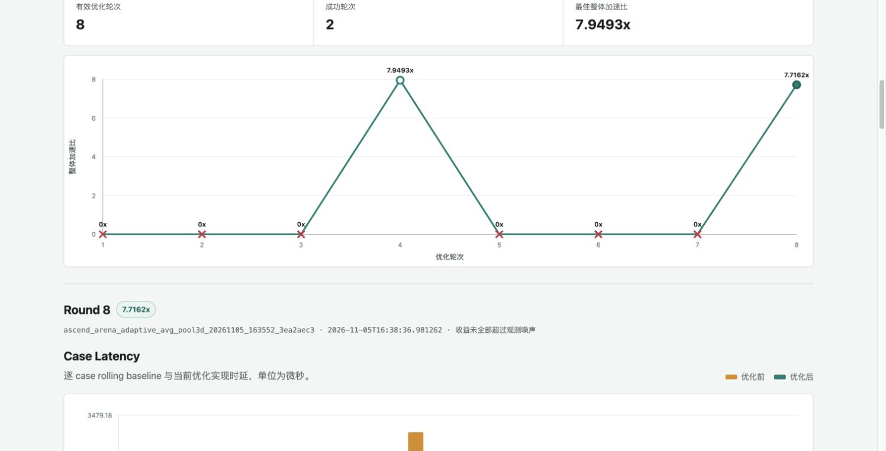
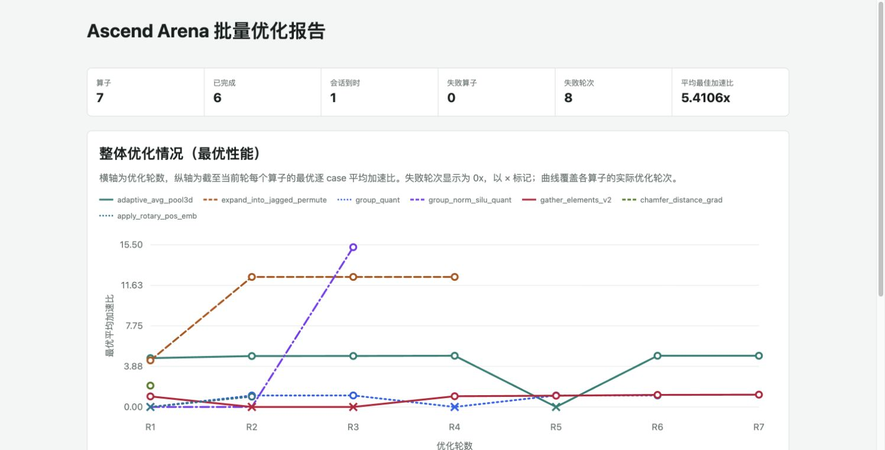
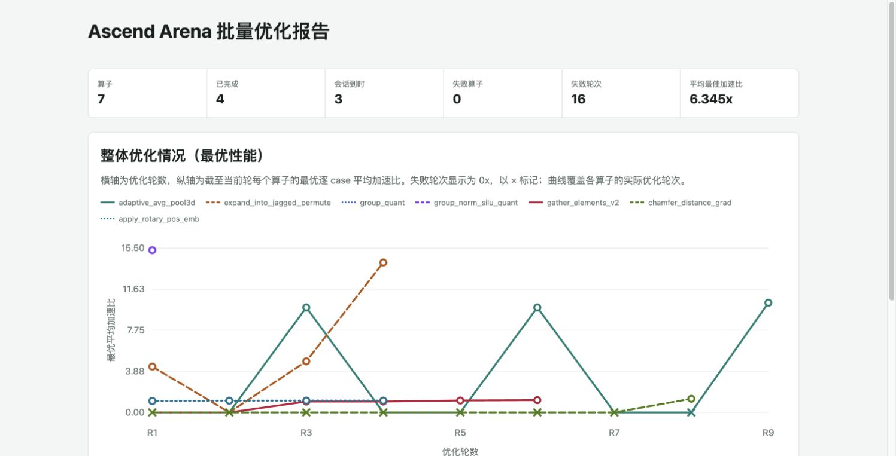

# Ascend Arena 优化任务测试报告

**本次结果：** 通过。六项验收已完成，两组批量任务均覆盖 7 个算子。性能表采用通过五阶段评测的实现。

## 1. 测试范围与环境信息

| 项目 | 记录 |
|---|---|
| 测试人、日期 | Codex；2026-11-05，Asia/Shanghai |
| 仓库 commit | `bb073790f3bbd698573062381f88030ee2914196`，包含工作树修改 |
| 测试范围 | 完整验收，当前 7 个算子；每 case 预热 10 次、采样 30 次 |


| 环境 | 记录 |
|---|---|
| 系统、Python、CANN 版本 | Linux 5.15.0-91-generic-aarch64；Python 3.10.20；CANN 9.1.0 |
| PyTorch/torch_npu 版本 | 2.8.0 / 2.8.0 |
| 芯片型号、使用卡数 | Ascend 910B4；4 张卡，逻辑卡 4–7，每卡一个任务 |
| Agent、模型与推理强度 | Claude Code 2.1.280；deepseek-flash；high；自定义 CannbotAgent 复用 claude profile |

## 2. 验收项

| 场景 | 验证内容 | 是否完成 |
|---|---|---|
| 工作区准备 | 构建单算子的工作区 | 通过 |
| 算子原始实现（基线）性能采集 | 在工作区内，运行算子评测，来查看是否正常采集到算子基线性能 | 通过 |
| 批量算子性能采集 | 均覆盖 7 个算子，指定卡批量运行算子评测，每卡单任务，查看是否正常采集到算子基线性能 | 通过 |
| 内置 Agent 单算子优化 | Agent 获得工作区和基线，日志更新，可调用评测，保留通过完整评测的优化实现 | 通过 |
| 内置 Agent 批量优化 | 覆盖 7 个算子，各任务初始化后启动 Agent，配置与进度完整保存 | 通过 |
| 构建自定义 Agent并进行优化评测（可选） | 模块与类可加载，profile 和 prompt 正确传入，7 个任务均保留通过完整评测的实现 | 通过 |

### 工作区准备

> 构建单算子的工作区

> 运行时长：2.014 秒

#### 命令

```bash
scripts/run_auto_pipeline.sh prepare \
  --operator adaptive_avg_pool3d \
  --device-id 4 \
  --output benchmark_runs/user-report-20261105-sg4nCj/single \
  --workspace-only
```

#### 运行产物

- 运行命令时终端截图/输出：执行工作区构建命令。
- 运行命令结束后终端截图/输出：已建立 adaptive_avg_pool3d 工作区，设备为卡 4；基线初始化未执行。
- 工作区文件目录截图（可选）：工作区包含实现源码、绑定、用例、参考实现和评测入口。
- 报错截图/输出（可选）：无。


### 算子原始实现（基线）性能采集

> 在工作区内，运行算子评测，来查看是否正常采集到算子基线性能

> 运行时长：159.180 秒

#### 命令

```bash
(
  cd benchmark_runs/user-report-20261105-sg4nCj/single/adaptive_avg_pool3d/work && ./validate.sh init --device-check require-idle
)
```

#### 运行产物

- 运行命令时终端截图/输出：启动基线编译与评测。
- 运行命令结束后终端截图/输出：终端 `tail -20` 输出如下。

  ```text
  [adaptive_avg_pool3d/init/NPU:4] 性能用例 开始 case_04
  [adaptive_avg_pool3d/init/NPU:4] 性能用例 开始 case_05
  [adaptive_avg_pool3d/init/NPU:4] 性能用例 开始 case_06
  [adaptive_avg_pool3d/init/NPU:4] 性能用例 开始 case_07
  [adaptive_avg_pool3d/init/NPU:4] 性能用例 开始 case_08
  [adaptive_avg_pool3d/init/NPU:4] 性能用例 开始 case_09
  [adaptive_avg_pool3d/init/NPU:4] 性能用例 开始 case_10
  [adaptive_avg_pool3d/init/NPU:4] 性能用例 通过 case_01 174.8930 μs 262.5700 μs
  [adaptive_avg_pool3d/init/NPU:4] 性能用例 通过 case_02 1708.9140 μs 1798.8800 μs
  [adaptive_avg_pool3d/init/NPU:4] 性能用例 通过 case_03 350.6970 μs 438.9200 μs
  [adaptive_avg_pool3d/init/NPU:4] 性能用例 通过 case_04 99.1320 μs 188.3900 μs
  [adaptive_avg_pool3d/init/NPU:4] 性能用例 通过 case_05 3106.4120 μs 3201.9900 μs
  [adaptive_avg_pool3d/init/NPU:4] 性能用例 通过 case_06 1494.2000 μs 1582.5200 μs
  [adaptive_avg_pool3d/init/NPU:4] 性能用例 通过 case_07 239.1750 μs 325.4600 μs
  [adaptive_avg_pool3d/init/NPU:4] 性能用例 通过 case_08 311.2660 μs 402.3700 μs
  [adaptive_avg_pool3d/init/NPU:4] 性能用例 通过 case_09 225.9545 μs 314.3100 μs
  [adaptive_avg_pool3d/init/NPU:4] 性能用例 通过 case_10 65.2710 μs 177.5000 μs
  [adaptive_avg_pool3d/init/NPU:4] 性能采集 通过  用例数=10
  [adaptive_avg_pool3d] 评测结束 2026-11-05T11:54:58.180326+08:00 耗时=158.900s 退出码=0
  [SUCCESS] 执行完成
  ```
- 工作区日志目录截图（可选）：编译、smoke、complete、profile 正确性和性能采集均通过。
- 报错截图/输出（可选）：无。

#### 算子基线性能

| 算子 | 测试时长 |
|---|---|
| adaptive_avg_pool3d | 158.900 秒 |

| 算子 | 实现 | 编译 | smoke 正确性 | complete 正确性 | profile 正确性 |
|---|---|---|---|---|---|
| adaptive_avg_pool3d | 基线 | 通过 | 通过 6/6 | 通过 49/49 | 通过 10/10 |

| 算子 profile case | 性能(us) |
|---|---|
| case_01 | 174.8930 |
| case_02 | 1708.9140 |
| case_03 | 350.6970 |
| case_04 | 99.1320 |
| case_05 | 3106.4120 |
| case_06 | 1494.2000 |
| case_07 | 239.1750 |
| case_08 | 311.2660 |
| case_09 | 225.9545 |
| case_10 | 65.2710 |

### 批量算子性能采集

> 均覆盖 7 个算子，指定卡批量运行算子评测，每卡单任务，查看是否正常采集到算子基线性能

> 运行时长：2351.269 秒

#### 命令

```bash
python scripts/batch_optimize.py \
  --operators adaptive_avg_pool3d,expand_into_jagged_permute,group_quant,group_norm_silu_quant,gather_elements_v2,chamfer_distance_grad,apply_rotary_pos_emb \
  --devices 5,6,7 \
  --output benchmark_runs/user-report-20261105-sg4nCj/batch
```

#### 运行产物

- 运行命令时终端截图/输出：在卡 5、6、7 上逐卡调度基线评测，每卡一个任务。
- 运行命令结束后终端截图/输出：评测汇总为 7 个算子通过，每个算子采集 10 个性能 case。
- 工作区文件目录截图（可选）：7 个算子分别建立独立工作区。
- 报错截图/输出（可选）：无。

#### 算子基线性能

| 算子 | 测试时长 |
|---|---|
| adaptive_avg_pool3d | 155.393 秒 |
| expand_into_jagged_permute | 126.903 秒 |
| group_quant | 295.233 秒 |
| group_norm_silu_quant | 241.245 秒 |
| gather_elements_v2 | 160.961 秒 |
| chamfer_distance_grad | 638.942 秒 |
| apply_rotary_pos_emb | 729.887 秒 |

| 算子 | 实现 | 编译 | smoke 正确性 | complete 正确性 | profile 正确性 | 是否正常采集算子性能 |
|---|---|---|---|---|---|---|
| adaptive_avg_pool3d | 基线 | 通过 | 通过 6/6 | 通过 49/49 | 通过 10/10 | 通过 10/10 |
| expand_into_jagged_permute | 基线 | 通过 | 通过 5/5 | 通过 62/62 | 通过 10/10 | 通过 10/10 |
| group_quant | 基线 | 通过 | 通过 5/5 | 通过 40/40 | 通过 10/10 | 通过 10/10 |
| group_norm_silu_quant | 基线 | 通过 | 通过 5/5 | 通过 26/26 | 通过 10/10 | 通过 10/10 |
| gather_elements_v2 | 基线 | 通过 | 通过 5/5 | 通过 22/22 | 通过 10/10 | 通过 10/10 |
| chamfer_distance_grad | 基线 | 通过 | 通过 5/5 | 通过 20/20 | 通过 10/10 | 通过 10/10 |
| apply_rotary_pos_emb | 基线 | 通过 | 通过 6/6 | 通过 23/23 | 通过 10/10 | 通过 10/10 |

### 内置 Agent 单算子优化

> Agent 获得工作区和基线，日志更新，可调用评测，保留通过完整评测的优化实现

> 运行时长：3601.181 秒

#### 命令

```bash
scripts/run_auto_pipeline.sh prepare \
  --operator adaptive_avg_pool3d \
  --device-id 4 \
  --output benchmark_runs/user-report-20261105-retest60/single \
  --agent claude \
  --agent-timeout 3600 \
  --resume
```

#### 运行产物

- 运行命令时终端截图/输出：启动 Agent 优化，记录各轮评测及源码变更。
- 运行命令结束后终端截图/输出：评测汇总：编译通过，smoke 6/6、complete 49/49、profile 正确性 10/10、性能采集 10/10。
- 工作区文件目录截图（可选）：保留优化实现和各轮评测结果。
- markdown文档性能表格截图/内容：kernel 时延取逐轮总时间的中位数，平均加速比取 10 个 case 加速比的算术平均。
- 网页端可视化截图（可选）：

  

  图中展示优化轨迹，性能表记录最近一次完整通过的评测。

#### 算子性能

| 算子 | 最终平均加速比 | 测试时长 |
|---|---|---|
| adaptive_avg_pool3d | 7.7162x | 3600.799 秒 |

| 算子 case ID | 基线时延 μs | 候选时延 μs | 加速比 |
|---|---|---|---|
| case_01 | 174.8930 | 195.6940 | 0.8937 |
| case_02 | 1708.9140 | 56.7310 | 30.1231 |
| case_03 | 350.6970 | 197.0440 | 1.7798 |
| case_04 | 99.1320 | 476.1695 | 0.2082 |
| case_05 | 3106.4120 | 159.1830 | 19.5147 |
| case_06 | 1494.2000 | 99.1215 | 15.0744 |
| case_07 | 239.1750 | 373.4870 | 0.6404 |
| case_08 | 311.2660 | 38.5810 | 8.0679 |
| case_09 | 225.9545 | 368.8470 | 0.6126 |
| case_10 | 65.2710 | 263.7655 | 0.2475 |

### 内置 Agent 批量优化

> 覆盖 7 个算子，各任务初始化后启动 Agent，配置与进度完整保存

> 运行时长：5110.156 秒

#### 命令

```bash
python scripts/batch_optimize.py \
  --agent claude \
  --operators adaptive_avg_pool3d,expand_into_jagged_permute,group_quant,group_norm_silu_quant,gather_elements_v2,chamfer_distance_grad,apply_rotary_pos_emb \
  --devices 5,6,7 \
  --agent-concurrency 3 \
  --output benchmark_runs/user-report-20261105-retest60/batch \
  --agent-timeout 3600
```

#### 运行产物

- 运行命令时终端截图/输出：启动 Agent 优化，记录各轮评测及源码变更。
- 运行命令结束后终端截图/输出：评测汇总：7 个算子均保留通过编译、smoke、complete、profile 正确性及性能采集的实现。
- 工作区文件目录截图（可选）：保留优化实现和各轮评测结果。
- 网页端可视化截图（可选）：

  

  图中展示优化轨迹，性能表记录最近一次完整通过的评测。

#### 算子性能

| 算子 | 最终平均加速比 | 测试时长 |
|---|---|---|
| adaptive_avg_pool3d | 4.8791x | 1506.743 秒 |
| expand_into_jagged_permute | 12.4045x | 687.957 秒 |
| group_quant | 1.0991x | 2645.232 秒 |
| group_norm_silu_quant | 15.2654x | 1190.842 秒 |
| gather_elements_v2 | 1.1736x | 2380.255 秒 |
| chamfer_distance_grad | 2.0360x | 1092.412 秒 |
| apply_rotary_pos_emb | 0.9868x | 3600.801 秒 |

### 构建自定义 Agent并进行优化评测（可选）

> 模块与类可加载，profile 和 prompt 正确传入，7 个任务均保留通过完整评测的实现

> 运行时长：7205.013 秒

#### 命令

```bash
mkdir -p benchmark_runs/user-report-20261105-retest60/custom-support
cat > benchmark_runs/user-report-20261105-retest60/custom-support/report_cannbot.py <<'PY'
import os
from pathlib import Path
from ascend_arena_e2e.agent_base import register_agent, load_agent_profiles
from ascend_arena_e2e.agents.claude_code import ClaudeCodeAgent

@register_agent
class CannbotAgent(ClaudeCodeAgent):
    name = "cannbot"

    def __init__(self, **kwargs):
        profile = load_agent_profiles()["claude"]
        values = {k: v for k, v in profile.items() if k != "harness" and v}
        values.update(kwargs)
        super().__init__(**values)

    def _skill_path(self):
        path = Path(os.environ["CANNBOT_SKILL_PATH"]).resolve()
        if not path.is_file():
            raise ValueError("Cannbot skill file is missing")
        return path

    def preflight(self, *, docker=False):
        super().preflight(docker=docker)
        self._skill_path()

    def setup_agents_md(self, workspace):
        super().setup_agents_md(workspace)
        with (workspace / "AGENTS.md").open("a") as out:
            out.write("\n## Cannbot skill\nRead and follow " + str(self._skill_path()) + " before editing.\n")
PY
cat > benchmark_runs/user-report-20261105-retest60/custom-support/SKILL.md <<'SKILL'
# Operator evaluation

Read AGENTS.md and the operator contract. Preserve the reference implementation, bindings, cases and baseline evidence. Validate meaningful implementation changes with ./validate.sh. Use the recorded correctness and performance results to guide further investigation. Finish with a validated implementation and report the measured outcome.
SKILL
export CANNBOT_SKILL_PATH="$PWD/benchmark_runs/user-report-20261105-retest60/custom-support/SKILL.md"
export PYTHONPATH="$PWD/benchmark_runs/user-report-20261105-retest60/custom-support:$PWD/src"
python scripts/batch_optimize.py \
  --agent report_cannbot:CannbotAgent \
  --operators adaptive_avg_pool3d,expand_into_jagged_permute,group_quant,group_norm_silu_quant,gather_elements_v2,chamfer_distance_grad,apply_rotary_pos_emb \
  --devices 4,5,6,7 \
  --agent-concurrency 4 \
  --output benchmark_runs/user-report-20261105-retest60/custom \
  --agent-timeout 3600
```

#### 运行产物

- 运行命令时终端截图/输出：启动 Agent 优化，记录各轮评测及源码变更。
- 运行命令结束后终端截图/输出：评测汇总：7 个算子均保留通过编译、smoke、complete、profile 正确性及性能采集的实现。
- 工作区文件目录截图（可选）：保留优化实现和各轮评测结果。
- 网页端可视化截图（可选）：

  

  图中展示优化轨迹，性能表记录最近一次完整通过的评测。

#### 算子性能

| 算子 | 最终平均加速比 | 测试时长 |
|---|---|---|
| adaptive_avg_pool3d | 10.3346x | 3600.818 秒 |
| expand_into_jagged_permute | 14.1780x | 1115.108 秒 |
| group_quant | 1.0863x | 3600.822 秒 |
| group_norm_silu_quant | 15.3904x | 1371.337 秒 |
| gather_elements_v2 | 1.1482x | 1846.728 秒 |
| chamfer_distance_grad | 1.2809x | 3008.820 秒 |
| apply_rotary_pos_emb | 1.0558x | 3600.652 秒 |
